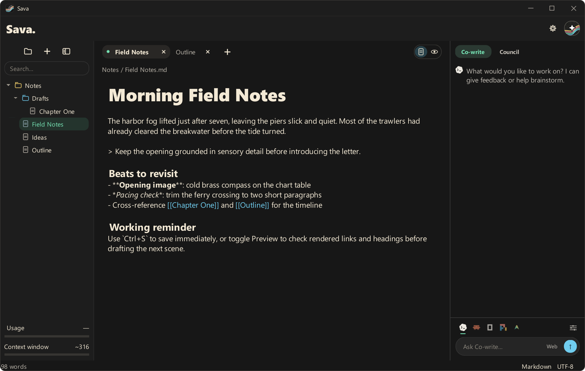
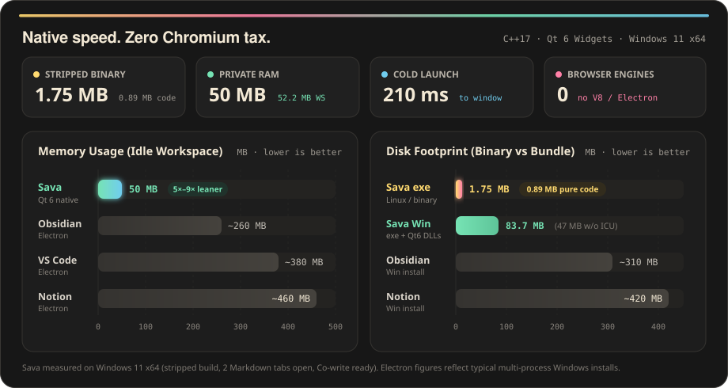

<p align="center">
  
</p>

<h1 align="center">Sava.</h1>

<p align="center">
  <strong>A native Markdown workspace that doesn't ship a whole web browser just to edit text.</strong><br/>
  C++17 &amp; Qt 6 Widgets · Co-write &amp; Council · Discord Rich Presence · Windows &amp; Linux
</p>

<p align="center">
  
</p>

---

## Why native? (Benchmarks)

Modern note apps shouldn't idle at half a gigabyte of RAM or burn 400 MB of disk space before you write a single sentence. Sava compiles down to a **1.75 MB** stripped binary (**0.89 MB** of actual C++17 code — the other half is literally the 1024 px icon), hits an interactive window in **210 ms**, and sits around **50 MB** of private RAM with multiple notes open.

<p align="center">
  
</p>

| Metric | Sava (C++17 / Qt 6) | Typical Electron Note App |
| :--- | :--- | :--- |
| **Stripped binary** | **1.75 MB** *(0.89 MB code + 0.86 MB icon)* | ~150–250 MB runtime |
| **Standalone Windows folder** | **83.7 MB** *(47.2 MB without ICU)* | ~300–450 MB installed |
| **Idle private RAM** | **50.0 MB** *(52.2 MB working set)* | ~260–460 MB across processes |
| **Cold start to window** | **210 ms** | ~1,200–2,500 ms |
| **Bundled Chromium instances** | **0** | 1+ |

---

## Highlights

- **Just plain Markdown** — ordinary UTF-8 `.md` files on disk, tabs, `[[wikilinks]]`, instant autosave, and a one-click rendered preview. No proprietary vault lock-in.
- **Co-write & Council** — talks directly to your already-installed **Codex**, **Claude Code**, **OpenCode**, **Pi**, and **Antigravity** harnesses using their existing sign-in. Switch models/effort on the fly, paste up to 3 images, enable web search, or run **Council** so multiple models build on and challenge each other.
- **Story context** — Co-write and Council start with compact excerpts selected using chapter order and note links. A harness can search for a passage, request the current draft or a full note, or work through the story note by note. Sava reads locally and sends requested pages to the selected harness as needed, with recent pages and compact findings carried forward.
- **Write into the note** — turn on **Write** in Co-write and the harness can append to, insert into, or replace passages of the open note itself. Each edit is one undo step (Ctrl+Z), and edits that can't be placed safely are left in the chat with an Insert button.
- **Custom system prompt** — add writing preferences in **Settings**. Sava appends them to the system instructions for each Co-write and Council request.
- **Native Discord Rich Presence** — direct Windows named-pipe / POSIX Unix-socket IPC (zero external RPC SDK). Toggle it in **Settings** (`Ctrl+,`), optionally hide note titles, and upload [`sava.png`](sava.png) as asset key `sava` in the Discord Developer Portal (or pass `SAVA_DISCORD_CLIENT_ID`).

---

## Build & Run

### Windows (MSYS2 UCRT64)

```sh
pacman -S --needed mingw-w64-ucrt-x86_64-gcc mingw-w64-ucrt-x86_64-pkgconf mingw-w64-ucrt-x86_64-make mingw-w64-ucrt-x86_64-qt6-base
```

```powershell
.\build.ps1
.\build\sava.exe
```

### Linux

Install a C++17 compiler, `make`, `pkg-config`, and Qt 6 Widgets dev headers, then:

```sh
make -j4
./build/sava
```

Pass any folder or `.md` file as an argument to jump straight in (`sava ~/Notes`).
