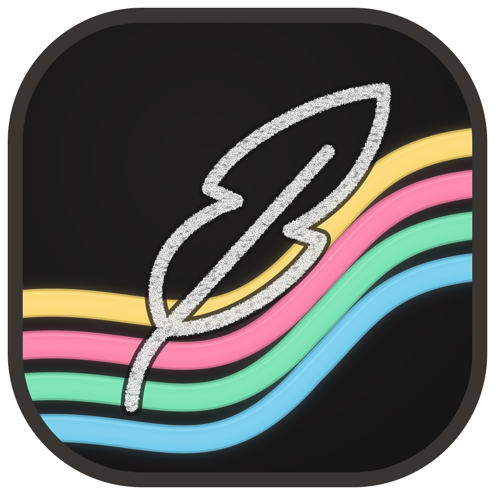

<p align="center">
  
</p>

<h1 align="center">Sava</h1>

<p align="center">
  A native Markdown workspace with Co-write, Council, and Discord Rich Presence. Built with C++17 and Qt 6 Widgets for Windows and Linux.
</p>

## Build and run

### Windows (MSYS2 UCRT64)

Install [MSYS2](https://www.msys2.org/) and the UCRT64 C++17 toolchain + Qt 6 Widgets packages:

```sh
pacman -S --needed mingw-w64-ucrt-x86_64-gcc mingw-w64-ucrt-x86_64-pkgconf mingw-w64-ucrt-x86_64-make mingw-w64-ucrt-x86_64-qt6-base
```

Then build and bundle standalone Qt/runtime DLLs into `build\`:

```powershell
.\build.ps1
.\build\sava.exe
```

Pass a folder or a Markdown file to open it directly:

```powershell
.\build\sava.exe "$env:USERPROFILE\Documents\Notes"
```

### Linux

Install a C++17 compiler, Make, pkg-config, and the Qt 6 Widgets development package. Then run:

```sh
make -j4
./build/sava
```

Pass a folder or a Markdown file to open it directly:

```sh
./build/sava ~/Notes
```

## Usage

Use the folder icon to attach additional folders. Opening a note adds a tab. Use **Ctrl+Tab** to switch tabs and **Ctrl+W** to close the active one. Notes remain ordinary UTF-8 files and edits autosave. The document and eye buttons switch between Edit and rendered Markdown Preview. **Ctrl+S** saves immediately. The striped star opens Co-write.

Click a folder row to expand or collapse it. Use **Shift+Click** to select a range or **Ctrl+Click** to select individual rows. Right-click to open selected notes, copy paths, create a note in a folder, or move selected notes to the Recycle Bin / Trash. **Delete** also moves selected notes to the Recycle Bin / Trash when the explorer has focus.

In the editor, use **Ctrl+B** for bold, **Ctrl+I** for italic, **Ctrl+Shift+X** for strikethrough, and **Ctrl+K** to insert a Markdown link.

Co-write starts the installed provider CLI/harness on demand (**Codex**, **Claude Code**, **OpenCode**, **Pi**, and **Antigravity**) and uses its existing sign-in. The sliders beside the provider logos open model and effort settings. You can also reach them through the Settings gear in the top bar. Use **Ctrl+,** to open Settings from the keyboard. Council sends each turn the earlier replies. These requests include a bounded excerpt from the active note and conversation.

Use **Reply** below a message to quote it in a follow-up. Paste up to three images into the composer with **Ctrl+V**. A vision-capable model is required to read them.

Turn on **Web** for a message to let Codex, Claude Code, OpenCode, or Antigravity look up references and include clickable source links. OpenCode uses its configured search integration. In Council, the first provider receives the images and can search. Later providers see its response.

The model dropdown loads the installed harness’s catalog when you open provider settings. Use the refresh button beside Model to reload it. Available models depend on the harness version and its provider configuration. Codex, Claude Code, and Antigravity report model-specific effort levels, and Pi reports which models support thinking.

The sidebar’s **Usage** meter shows the selected provider’s account quota for Codex or Claude Code when the CLI reports it. Hover for both quota windows and reset times, or click **Usage** to refresh. **Context window** estimates the note and conversation size independently and fills when the CLI supplies a model limit.

## Discord Rich Presence

Open **Settings** (**Ctrl+,**) to enable Discord Rich Presence, toggle whether your current note title is shown, and set your Discord Application ID (or pass `SAVA_DISCORD_CLIENT_ID` in the environment). Upload [`sava.png`](sava.png) as a Rich Presence art asset named `sava` in the Discord Developer Portal to display the Sava icon on your profile.
